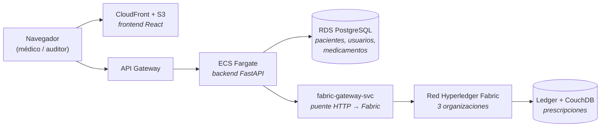
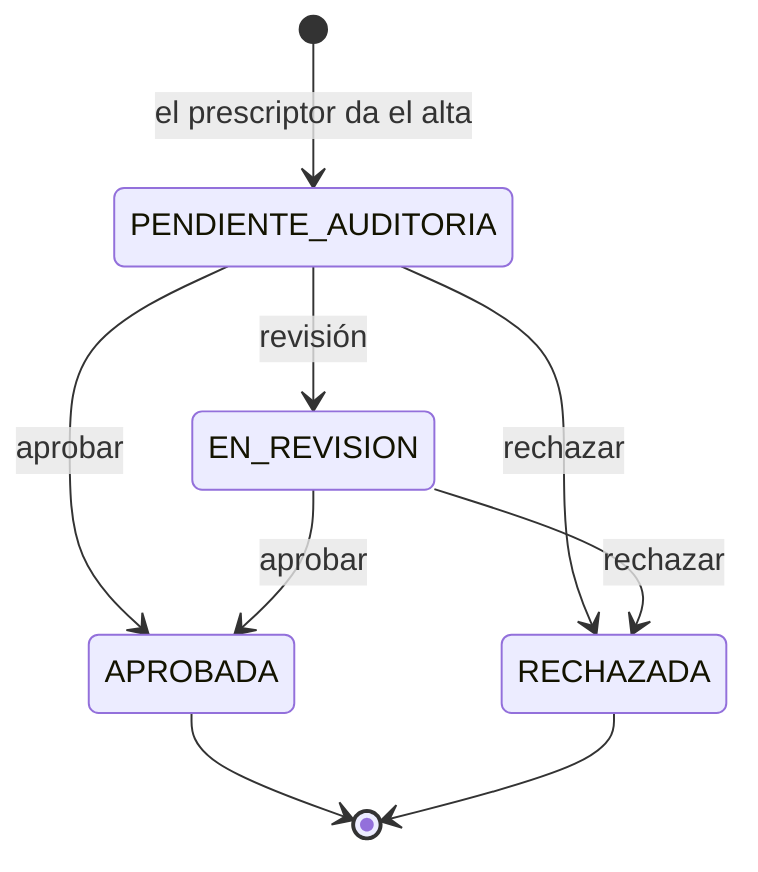
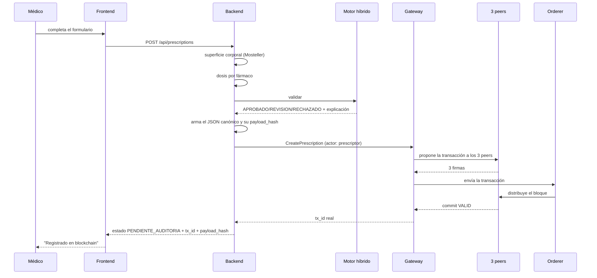

# 07 — Cómo funciona todo

Guía de lectura del sistema completo: qué hace, qué piezas lo componen, cómo
conversan entre sí y por qué está armado así. Pensado para entenderlo de cero,
sin haber tocado el código.

> Los otros documentos son operativos (cómo desplegar, cómo usar los scripts).
> Este es **conceptual**: acá se explica el *por qué*. Si venís a ejecutar algo,
> arrancá por [03-uso.md](03-uso.md) o [06-deploy-cambios-onchain.md](06-deploy-cambios-onchain.md).

---

## 1. El problema que resuelve

Un médico oncólogo prescribe un tratamiento de quimioterapia caro. Antes de que
la prepaga lo pague, alguien tiene que auditarlo: ¿el esquema es el adecuado
para ese estadio? ¿las dosis están bien calculadas? ¿se justifica el costo?

Ese circuito tiene tres partes que no confían ciegamente entre sí:

| Actor | Qué quiere |
|---|---|
| **Centro prescriptor** | Que no le cambien lo que prescribió |
| **Auditoría médica** | Que la prescripción que audita sea la que se emitió |
| **Prepaga / financiador** | Poder verificar que el dictamen no se fabricó después |

El sistema hace dos cosas:

1. **Asiste** al médico: un motor híbrido (reglas clínicas + modelo de machine
   learning) evalúa la prescripción y calcula dosis y costos.
2. **Deja constancia inalterable**: la prescripción y cada acción del auditor se
   escriben en una blockchain privada donde **las tres organizaciones tienen que
   firmar** para que algo entre. Ninguna puede modificar el registro después.

Ese segundo punto es la razón de ser del proyecto. Todo lo demás está al
servicio de eso.

---

## 2. Vista de 10.000 pies



Cuatro capas, y una regla que las ordena a todas:

> **Los datos del paciente viven en PostgreSQL. Las prescripciones viven
> exclusivamente en la blockchain.** No hay copia de la prescripción en la base
> relacional — ni siquiera para consultar rápido.

Esa separación es deliberada y es lo que hace que la garantía valga algo. Si
existiera una copia en Postgres, cualquiera con acceso a la base podría
mostrarte una prescripción distinta de la que está en el ledger.

---

## 3. La infraestructura en AWS

### 3.1 El mapa

```
                          Internet
                              │
        ┌─────────────────────┼──────────────────────┐
        │                     │                      │
   ┌────▼─────┐         ┌─────▼──────┐               │
   │CloudFront│         │API Gateway │               │
   │ + S3     │         │ vl5nsf5jt5 │               │
   │(frontend)│         └─────┬──────┘               │
   └──────────┘               │ VPC Link             │ SSH (22)
                              │                      │
   ══════════════════════════ │ ════════════════     │
    VPC medchain-vpc          │                      │
    10.0.0.0/16               │                      │
                       ┌──────▼────────┐             │
                       │  ECS Fargate  │             │
                       │medchain-backend│            │
                       └───┬────────┬──┘             │
                           │        │                │
                    ┌──────▼──┐     │                │
                    │   RDS   │     │ 8081           │
                    │Postgres │     │                │
                    └─────────┘     │                │
   ══════════════════════════════   │ ═══════════    │
                                    │                │
                          VPC peering (pcx-0404…)    │
                                    │                │
   ══════════════════════════════   │ ═══════════════│═══
    VPC default 172.31.0.0/16       │                │
                              ┌─────▼────────────────▼──┐
                              │  EC2  i-0331b3fbeaadee294│
                              │  172.31.89.189  t3.large │
                              │  ┌────────────────────┐  │
                              │  │ fabric-gateway:8081│  │
                              │  ├────────────────────┤  │
                              │  │ orderer + 3 peers  │  │
                              │  │ + 3 CouchDB + cli  │  │
                              │  └────────────────────┘  │
                              └──────────────────────────┘
```

### 3.2 Pieza por pieza

**CloudFront + S3** — El frontend es una aplicación React compilada a archivos
estáticos. No hay servidor: S3 los guarda y CloudFront los distribuye. Cuando
abrís la app, el navegador se descarga el JavaScript y a partir de ahí habla
directo con la API.

**API Gateway + VPC Link** — La puerta de entrada al backend. Las tareas de ECS
no tienen dirección pública fija (cambian en cada despliegue), así que API
Gateway las encuentra a través de **Cloud Map**, un directorio donde ECS
registra automáticamente la IP y el puerto de cada tarea que levanta.

> 💡 **Detalle que costó caro**: Cloud Map puede registrar solo la IP (registros
> tipo `A`) o IP + puerto (registros `SRV`). API Gateway **necesita el puerto**.
> El servicio original usaba registros `A` y por eso la API devolvía error 500 en
> todas las rutas. Está explicado en [06 §3.2](06-deploy-cambios-onchain.md).

**ECS Fargate** — Corre el backend en contenedores sin que haya que administrar
servidores. Si la tarea muere, ECS levanta otra sola. Hoy corre una sola
instancia (`desiredCount=1`), pero el diseño soporta varias: las sesiones se
guardan en la base, no en la memoria del proceso.

**RDS PostgreSQL** — Pacientes, usuarios, medicamentos y monodrogas. **No
guarda prescripciones**: esas tablas se eliminaron a propósito en la migración
007.

**EC2 con la red Fabric** — Una única máquina `t3.large` donde corre toda la
blockchain: el orderer, los tres peers, sus tres bases CouchDB y el puente HTTP.
Está en la VPC por defecto, separada de la VPC de la aplicación.

**VPC peering** — Como el backend y la blockchain viven en VPCs distintas, hace
falta un túnel privado entre ambas. Sin esto, el tráfico tendría que salir a
internet. Con el peering, ECS llega a la EC2 por su IP privada
(`172.31.89.189:8081`) y el puerto 8081 solo acepta conexiones desde
`10.0.0.0/16`.

### 3.3 Puertos dentro de la EC2

| Componente | Puerto | Para qué |
|---|---|---|
| `fabric-gateway` | 8081 | **Único puerto que el backend usa** |
| `orderer.medchain.com` | 7050 | Ordena las transacciones en bloques |
| `peer0.prescriptor` | 7051 | Peer del centro prescriptor |
| `peer0.auditoria` | 9051 | Peer de la auditoría médica |
| `peer0.prepaga` | 11051 | Peer del financiador |
| `couchdb.*` | 5984 / 7984 / 9984 | Estado actual de cada peer |

---

## 4. El frontend

React + Vite. Una *single page application*: se carga una vez y después navega
sin recargar la página.

### 4.1 Cómo se organiza

```
frontend/src/
├── pages/          una pantalla cada uno (PrescripcionPage, AuditQueuePage…)
├── components/     piezas reutilizables (DataTable, StatusChip, Sidebar…)
├── api/            un archivo por recurso; todos pasan por client.js
├── auth/           AuthContext (sesión) + ProtectedRoute (permisos)
└── hooks/          lógica compartida de formularios
```

La pieza clave es `api/client.js`: **todas** las llamadas al backend pasan por
ahí. Ese archivo agrega el token de sesión, maneja los errores y traduce los
códigos HTTP. Si el backend responde 503 porque la blockchain no contesta, es
`client.js` quien lo convierte en un mensaje entendible.

### 4.2 Quién ve qué

El menú lateral y las rutas se derivan del rol del usuario. No es solo cosmético:
`ProtectedRoute` bloquea la navegación, y el backend **vuelve a verificar** el
permiso en cada pedido. La seguridad real está en el backend; el frontend solo
evita mostrar pantallas inútiles.

| Pantalla | prescriptor | auditor | administrador | super_admin |
|---|:--:|:--:|:--:|:--:|
| Alta de prescripción | ✅ | | | ✅ |
| Historial de prescripciones | ✅ | ✅ | | ✅ |
| Trazabilidad | ✅ | ✅ | | ✅ |
| Cola de auditoría / caso | | ✅ | | ✅ |
| Pacientes | ✅ | | ✅ | ✅ |
| Medicamentos y monodrogas | | | ✅ | ✅ |
| Usuarios | | | | ✅ |
| Salud del sistema | | | | ✅ |

### 4.3 Paginación por *bookmark*

Las listas no usan "página 1, 2, 3". CouchDB devuelve un **bookmark**: una cadena
opaca que significa "seguí desde acá". El frontend la guarda y la manda en el
pedido siguiente, con un botón *cargar más*.

Es distinto de lo que uno espera de una base relacional, y tiene un motivo: en
un ledger que solo crece, saltar a "la página 7" no es una operación barata ni
estable — si entran registros nuevos, el contenido de esa página cambia. El
bookmark es un puntero firme.

---

## 5. El backend

Python con FastAPI. Expone 26 rutas y está armado en capas, cada una con una
única responsabilidad:

```
routers/       reciben el HTTP, validan permisos     ← lo único que sabe de HTTP
   ↓
services/      la lógica del negocio                  ← el corazón
   ↓
repositories/  hablan con el almacenamiento           ← lo único que sabe de dónde salen los datos
   ↓
PostgreSQL  |  fabric-gateway-svc
```

La ventaja de esa separación se ve justo acá: cuando las prescripciones pasaron
de PostgreSQL a la blockchain, **solo cambió el repositorio**. El servicio que
calcula dosis y valida no se enteró.

### 5.1 Los repositorios

| Repositorio | Habla con | Guarda |
|---|---|---|
| `patient_repo` | PostgreSQL | Pacientes (con PHI cifrada) |
| `user_repo` | PostgreSQL | Usuarios y roles |
| `medication_repo`, `monodrug_repo` | PostgreSQL | Catálogo de fármacos |
| `fabric_prescription_repo` | **fabric-gateway-svc** | Prescripciones |

### 5.2 El motor de validación

`validation_service` combina dos enfoques:

1. **Reglas deterministas** (`ml/reglas.py`, `ml/guias.py`) — Conocimiento
   clínico explícito: qué esquema corresponde a qué estadio, qué combinaciones
   están contraindicadas.
2. **Modelo LightGBM** (`ml/model_loader.py`) — Entrenado con prescripciones
   históricas, devuelve una probabilidad de concordancia y qué variables pesaron
   en esa decisión.

El resultado se resuelve con **doble umbral**: por encima del alto, `APROBADO`;
por debajo del bajo, `RECHAZADO`; en el medio, `REVISION`. El modelo también
explica su salida (`features_relevantes` con el aporte de cada variable), que es
lo que después ve el auditor.

> ⚠️ **Distinción importante**: el veredicto del modelo es una **opinión que
> queda registrada**, no una decisión. Toda prescripción nace
> `PENDIENTE_AUDITORIA` en la blockchain, sin importar lo que haya dicho el
> modelo. Quien decide es siempre una persona.

### 5.3 Sesiones y contraseñas

- Las contraseñas se guardan con **Argon2id**, con migración transparente: si
  una cuenta todavía tiene el hash viejo SHA-256, el primer login exitoso la
  re-hashea sola.
- Las sesiones viven en la tabla `auth_tokens` (no en la memoria del proceso).
  Por eso se puede escalar a varias tareas de ECS sin romper el login.

### 5.4 Fallar rápido y fallar fuerte

Dos comportamientos que parecen defectos y son intencionales:

**Arranque.** Con `ENVIRONMENT=production`, el backend **se niega a arrancar** si
falta `DATABASE_URL`, `FABRIC_GATEWAY_URL` o `GATEWAY_AUTH_TOKEN`. Prefiere no
levantar antes que atender pedidos que va a contestar mal.

**Escritura.** El alta de una prescripción escribe en Fabric **dentro del
pedido**. Si la red no responde, la respuesta es `503` y no queda nada a medias.
No hay cola asíncrona ni reintento en segundo plano: o la prescripción está en
el ledger, o no existe.

---

## 6. La blockchain

Acá está lo que hace distinto al proyecto. Vale la pena entenderlo bien.

### 6.1 Por qué Hyperledger Fabric y no Bitcoin o Ethereum

Fabric es una blockchain **permisionada**: no cualquiera se suma, no hay minería
ni criptomoneda, y se sabe exactamente quién firmó cada cosa. Eso es justo lo
que hace falta cuando los participantes son organizaciones identificadas que
tienen que rendir cuentas.

### 6.2 Las tres organizaciones

| Organización | MSP | Representa | Puede |
|---|---|---|---|
| Prescriptor | `PrescriptorMSP` | Centro médico | **Crear** prescripciones + leer |
| MedChain | `MedChainMSP` | Auditoría médica | **Auditar** + leer |
| Prepaga | `PrepagaMSP` | Financiador | Solo **leer** |

Cada una tiene su propio peer, su propia copia del ledger y su propia identidad
criptográfica (certificados X.509). El **MSP** es el mecanismo por el cual la red
sabe qué organización firmó una transacción.

El control de acceso está en el chaincode, no en el backend:

```go
// contract.go — solo el prescriptor crea
if err := requireMSP(msp, MSPPrescriptor); err != nil { return err }

// solo la auditoría dictamina
if err := requireMSP(msp, MSPMedChain); err != nil { return err }
```

Aunque alguien tomara el control del backend, no podría hacer que la prepaga
apruebe una prescripción: la red lo rechaza.

### 6.3 La política de endorsement: la garantía central

```
AND('PrescriptorMSP.peer', 'MedChainMSP.peer', 'PrepagaMSP.peer')
```

Para que **cualquier** escritura entre al ledger, los tres peers tienen que
ejecutarla por separado, obtener el mismo resultado y firmarlo. Si una sola
organización intentara alterar algo, las otras dos producirían un resultado
distinto y la transacción se rechaza.

Es una decisión con costo, y conviene tenerlo presente: **si un peer se cae, no
se puede escribir nada**. Se eligió la garantía por sobre la disponibilidad, que
para un registro de auditoría es lo razonable. La pantalla de Salud muestra el
estado de los tres justamente por esto.

> 💡 Para que esta política funcione hacen falta **anchor peers** declarados en
> `configtx.yaml`. Sin ellos los peers de distintas organizaciones no se
> descubren entre sí y toda escritura falla con *"no peer combination can satisfy
> the endorsement policy"*. Fue uno de los bloqueantes del despliegue.

### 6.4 El ciclo de vida de una prescripción



Las transiciones las valida **el chaincode**, no el backend. `APROBADA` y
`RECHAZADA` son estados finales: no hay vuelta atrás ni edición posterior.

### 6.5 La cadena de hashes

Cada prescripción arrastra una cadena de huellas digitales encadenadas:

```
payload_hash = SHA256(contenido clínico + veredicto del modelo + fecha)
       │
       ├─► event_hash₁ = SHA256(payload_hash │ "revision" │ estado │ auditor │ SHA256(justificación) │ fecha)
       │          │
       │          └─► event_hash₂ = SHA256(event_hash₁ │ "aprobar" │ … )
       │
   current_hash = último eslabón
```

Cambiar cualquier cosa —un dato clínico, una justificación, el orden de los
dictámenes— rompe todos los eslabones siguientes. El endpoint
`GET /api/prescriptions/{id}/verify` recalcula la cadena entera y devuelve
`valido: true/false`. La UI muestra el chip *"Cadena de hashes verificada"*.

Lo importante: **la verificación no depende de confiar en el sistema**.
Cualquiera con el asset y la convención documentada en [HASHING.md](HASHING.md)
puede recalcular los hashes por su cuenta y llegar al mismo resultado.

> 💡 **Un detalle sutil que rompía todo**: CouchDB normaliza los números y
> devuelve `174.0` como `174`. Como el hash se calculaba sobre la forma con
> `.0`, el asset releído nunca reproducía su propio `payload_hash` y `/verify`
> daba inválido para toda prescripción real. Por eso la canonicalización ahora
> normaliza los flotantes enteros antes de hashear.

### 6.6 El puente: `fabric-gateway-svc`

El backend está en Python; Fabric habla gRPC con certificados. En el medio hay un
servicio en Go que traduce:

```
backend (Python)  ──HTTP + X-Gateway-Token──►  fabric-gateway-svc (Go)  ──gRPC──►  peers
```

Hace tres cosas:

1. **Mantiene tres identidades** (una por organización) y elige la correcta según
   la operación.
2. **Impone el actor**: `CreatePrescription` solo sale firmada como prescriptor,
   `AuditPrescription` solo como auditor. Ni siquiera un backend comprometido
   podría pedir otra cosa.
3. **Traduce errores** de Fabric a códigos HTTP que el backend entiende.

Su `/health` consulta las tres organizaciones y es lo que alimenta la pantalla de
Salud del sistema.

### 6.7 Por qué CouchDB

Cada peer guarda el "estado actual" en una base CouchDB. Eso permite consultas
ricas —"todas las prescripciones `PENDIENTE_AUDITORIA` ordenadas por fecha"—
que con el almacenamiento por defecto de Fabric no se podrían hacer.

El precio es que esas consultas necesitan **índices declarados**, que viajan
dentro del paquete del chaincode
(`chaincode/prescription-contract/META-INF/statedb/couchdb/indexes/`). Sin ellos
las consultas fallan en tiempo de ejecución, aunque todo lo demás funcione.

---

## 7. El recorrido completo de una prescripción

Acá se junta todo. Seguimos una prescripción desde que el médico aprieta
*Guardar* hasta que la prepaga la verifica.



**Paso a paso, con lo que importa de cada etapa:**

1. **El médico carga los datos.** Paciente, diagnóstico, estadificación TNM,
   marcadores (MSI, RAS, BRAF), régimen.

2. **El backend calcula.** Superficie corporal por la fórmula de Mosteller, y a
   partir de ahí las dosis de cada fármaco del régimen.

3. **El motor híbrido opina.** Reglas + modelo. Devuelve un veredicto, una
   probabilidad, las variables que más pesaron y el costo estimado.

4. **Se arma el payload canónico.** Un JSON con las claves ordenadas
   alfabéticamente y sin espacios — la forma canónica es lo que hace que el hash
   sea reproducible. Se calcula el `payload_hash`.

5. **Se escribe en Fabric, sincrónicamente.** El gateway propone la transacción
   a los tres peers. Cada uno la ejecuta por su cuenta. Si los tres coinciden,
   firman.

6. **El orderer arma el bloque** y lo distribuye. Los peers lo validan y lo
   commitean.

7. **Vuelve un `tx_id` real**, el estado `PENDIENTE_AUDITORIA` y el
   `payload_hash`. Recién ahí el médico ve la confirmación.

8. **El auditor la ve en su cola** (consulta rica sobre CouchDB, paginada por
   bookmark) con toda la explicación del modelo a la vista.

9. **El auditor dictamina.** `revisión`, `aprobar` o `rechazar`, siempre con
   justificación. Cada acción es una transacción nueva, firmada como
   `MedChainMSP`, que agrega un eslabón a la cadena de hashes.

10. **Cualquiera verifica.** `/verify` recalcula la cadena entera; `/history`
    devuelve las transacciones reales del ledger con sus `tx_id`.

---

## 8. Los datos del paciente

Las prescripciones están en la blockchain, pero **los datos identificatorios del
paciente no**. Una blockchain es inmutable, y datos personales inmutables chocan
de frente con el derecho al borrado.

La solución: en el ledger solo va un `patient_id` numérico (seudónimo). Los datos
reales quedan en PostgreSQL, cifrados:

| Mecanismo | Para qué |
|---|---|
| **AES-256-GCM** | Cifra cada campo sensible por separado |
| **AAD** con `patient_id` + nombre del campo | Impide mover un dato cifrado de un paciente a otro |
| **Índice ciego** (HMAC-SHA256) | Permite buscar por nombre exacto **sin descifrar** |
| **HKDF** | Deriva claves distintas para cifrar y para indexar |
| **`phi_access_log`** | Registra cada acceso a datos personales |

La clave maestra vive en AWS Secrets Manager; la aplicación la lee en tiempo de
ejecución usando su rol de IAM y nunca la escribe en logs.

El índice ciego es la parte ingeniosa: guarda un HMAC del apellido, que permite
encontrar coincidencias exactas comparando HMACs, sin que la base tenga nunca el
apellido en claro.

---

## 9. Cómo se despliega

```
git push a `desarrollo`
        │
        ├─► CI (ci.yml)      tests Python + Go, lint, anti-drift del esquema
        │
        └─► Deploy (deploy.yml), según qué cambió:
              ├─ backend/**      → build, push a ECR, nueva tarea en ECS
              ├─ frontend/**     → build, sync a S3, invalidación de CloudFront
              └─ chaincode/**    → por SSM en la EC2: deployCC + rebuild del gateway
```

También se puede desplegar **a mano** desde la pestaña Actions
(*workflow_dispatch*), eligiendo por checkbox qué desplegar. Sirve para
redesplegar sin commitear: por ejemplo tras rehacer la red o rotar un secreto.

Dos protecciones que vale conocer:

- **Las migraciones corren solas al arrancar el contenedor.** Si una falla, el
  contenedor no levanta.
- **El pipeline detecta los rollbacks de ECS.** Si las tareas nuevas no arrancan,
  ECS revierte a la versión anterior y el servicio *igual* queda estable — con lo
  cual un chequeo ingenuo daría verde sobre un despliegue fallido. El workflow
  compara el identificador del despliegue antes y después.

---

## 10. Glosario

| Término | Qué es |
|---|---|
| **Asset** | El registro de una prescripción dentro del ledger |
| **Chaincode** | El programa que corre dentro de la blockchain (el "contrato inteligente") |
| **MSP** | *Membership Service Provider*: el mecanismo por el que la red identifica a qué organización pertenece quien firma |
| **Peer** | Nodo de una organización: guarda el ledger y ejecuta el chaincode |
| **Orderer** | Nodo que ordena las transacciones y arma los bloques |
| **Endorsement** | Las firmas que una transacción necesita antes de poder entrar |
| **Canal** | El "libro contable" compartido. Acá hay uno solo: `mychannel` |
| **Bookmark** | Puntero opaco de CouchDB para continuar una consulta paginada |
| **PHI** | *Protected Health Information*: datos de salud identificatorios |
| **Índice ciego** | HMAC de un dato que permite buscarlo sin descifrarlo |
| **ULID** | Identificador único que además ordena cronológicamente |
| **Seudónimo** | Identificador que reemplaza al dato real (acá, `patient_id`) |

---

## 11. Para seguir leyendo

| Documento | Qué encontrás |
|---|---|
| [02-arquitectura.md](02-arquitectura.md) | Topología de la red Fabric en detalle |
| [03-uso.md](03-uso.md) | Cómo levantar y operar la red localmente |
| [HASHING.md](HASHING.md) | La convención de hashes, con vectores de prueba |
| [06-deploy-cambios-onchain.md](06-deploy-cambios-onchain.md) | El despliegue en AWS y los bloqueantes que aparecieron |
| [04-aws-ec2-setup.md](04-aws-ec2-setup.md) | Preparación de la EC2 |
